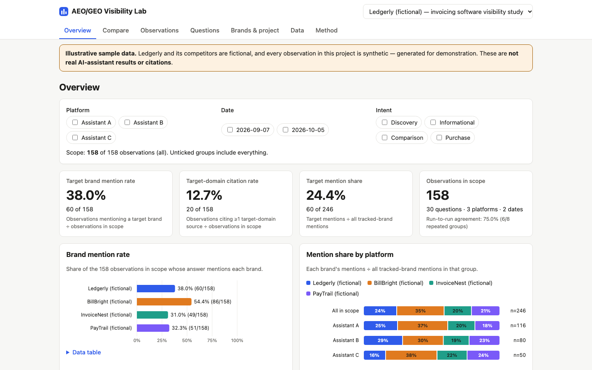

# AEO/GEO Visibility Research Lab

A browser-based research tool for **answer-engine / generative-engine optimisation (AEO/GEO)**: record how AI
assistants answer a fixed set of buyer questions, which brands they mention and which sources they cite, then
measure brand mention rate, target-domain citation rate, competitor mention share and citation sources —
with the sample size beside every number.

**Live demo:** https://dash-boop0.github.io/aeo-geo-visibility-lab/
**Source:** https://github.com/Dash-boop0/aeo-geo-visibility-lab



> **About the sample data.** The bundled sample project ("Ledgerly (fictional)", invoicing software) is
> **illustrative and synthetic**: fictional brands, `example.*` domains, and observations generated by a seeded
> random process. It is **not** a record of real AI-assistant answers or citations, and the app shows a
> persistent banner saying so whenever it is open.

## Why

Teams increasingly ask "do AI assistants recommend us?" — and answer with a few screenshots. This lab turns that
into a small, repeatable experiment: fixed prompts, logged date/platform/settings, explicit metric definitions,
honest handling of missing data and small samples, and exports you can put in a report.

## Features

- **Projects → brands → questions → observations.** Target and competitor brands with their website domains
  (subdomains match automatically) and aliases.
- **Buyer-intent question sets** grouped by discovery, informational, comparison and purchase; add by hand or
  import from CSV (duplicates detected).
- **Manual observation logging**: platform, date, run number, exact prompt, settings, answer summary, brands
  mentioned (with an optional "suggest from summary" helper), cited URLs and cited domains. Validation with clear
  messages; edit and delete.
- **CSV import of observations** from a documented template, with per-row errors and warnings; re-importing is
  idempotent.
- **Metrics** (see definitions below) with numerator/denominator, "n/a" for empty denominators and a
  low-sample flag for n < 10.
- **Comparisons across dates and platforms** only where both sides have data, on matched questions by default,
  plus a platform × date coverage grid that lists missing combinations.
- **Charts** (hand-drawn SVG: bar, 100 % stacked bar, line) with hover/focus tooltips and data-table fallbacks;
  light and dark themes.
- **Exports**: processed metrics CSV (long format), observations CSV (re-importable), questions CSV and a
  Markdown report. JSON backup/restore, reset, and a one-click illustrative sample.
- Runs entirely in the browser: no accounts, API keys, scraping, trackers or network requests.

## Quick start

Requirements: a modern browser. Python 3 or Node.js is only needed to serve the files locally (ES modules do not
load from `file://`). Node ≥ 18 is needed to run the tests.

**macOS / Linux**

```bash
git clone https://github.com/Dash-boop0/aeo-geo-visibility-lab.git
cd aeo-geo-visibility-lab
python3 -m http.server 8000      # or: npx serve .
# open http://localhost:8000
```

**Windows (PowerShell)**

```powershell
git clone https://github.com/Dash-boop0/aeo-geo-visibility-lab.git
cd aeo-geo-visibility-lab
py -m http.server 8000           # or: npx serve .
# open http://localhost:8000
```

There is nothing to install and no build step. GitHub Pages serves the repository root as-is (`.nojekyll`).

## How to use

1. **Load the illustrative sample** to explore, or **create an empty project**.
2. **Brands & project**: add your brand as *target* and each competitor, with their domains.
3. **Questions**: add your fixed buyer questions or import `sample-data/questions-template.csv`.
4. **Observations**: ask each assistant each question (new chat, same wording every round) and log the answer —
   or import a CSV based on `sample-data/observations-template.csv`.
5. **Overview**: filter by platform, date and intent; read rates with their n.
6. **Compare**: two dates or two platforms, matched questions, missing data shown explicitly.
7. **Data**: export metrics CSV / Markdown report; back up your data as JSON.

A 2-minute walkthrough is in [docs/DEMO.md](docs/DEMO.md); the full method is in
[docs/METHODOLOGY.md](docs/METHODOLOGY.md).

## Data model

```
Project { name, description, illustrative, brands[], questions[], observations[] }
Brand { name, role: target | competitor, domains[], aliases[] }
Question { id, text, intent: discovery | informational | comparison | purchase, notes }
Observation { questionId, platform, date (YYYY-MM-DD), run, prompt, settings, answerSummary,
              brandsMentioned[], citedUrls[], citedDomains[], notes }
```

Cited domains used in metrics = hosts of cited URLs ∪ manually logged domains, lower-cased with `www.` removed.
More detail: [docs/ARCHITECTURE.md](docs/ARCHITECTURE.md).

## Metric definitions

*n* = observations in scope (after filters). Every rate is shown with numerator/denominator; a zero denominator
shows **n/a**; denominators under **10** are flagged **⚠ low n**.

| Metric | Definition |
|---|---|
| Brand mention rate | observations mentioning the brand ÷ n |
| Target brand mention rate | observations mentioning ≥1 target brand ÷ n |
| Target-domain citation rate | observations citing ≥1 URL/domain on a target-brand domain (incl. subdomains) ÷ n |
| Any-citation rate | observations citing ≥1 source ÷ n |
| Mention share (competitor mention share) | mentions of the brand ÷ all tracked-brand mentions (once per brand per observation) |
| Citation-source frequency | observations citing the domain (once per observation) ÷ n, with cited-URL count alongside |
| Run-to-run agreement | question × platform × date groups with ≥2 runs whose runs agree on target mention ÷ such groups |
| Comparison change | metric(B) − metric(A) in percentage points, on questions observed on both sides; only when both sides have data |

Worked examples with hand-computed values: [docs/METHODOLOGY.md §5](docs/METHODOLOGY.md#5-metric-definitions).

## Sample data

`sample-data/` contains CSV templates, the 30-question synthetic sample (8 discovery, 8 informational,
7 comparison, 7 purchase), 158 synthetic observations across three generic platform labels ("Assistant A/B/C")
and two dates — with a deliberate gap (Assistant C not observed on the first date) and a repeated run for the
discovery questions — and a JSON backup of the same project. See [sample-data/README.md](sample-data/README.md)
for column definitions. Regenerate with `npm run sample-data`.

## Tests

```bash
npm test        # runs: node --test   (Node's built-in runner, no dependencies)
```

63 tests cover the CSV parser/serialiser (quotes, embedded newlines, BOM, CRLF, injection guard), domain/date
validation, every metric against hand-computed fixtures (including empty data → n/a), comparisons with missing
sides, import/export round trips (the sample CSVs re-import to identical metrics), sample determinism and chart
output.

UI verification (done before release, script not shipped): a Playwright run loads the sample, filters, compares,
adds/edits/deletes an observation, adds questions and brands, imports both sample CSVs into a new project,
downloads every export, resets and restores a backup, checks persistence after reload, checks for console errors
and confirms no horizontal scrolling at 375 px on every page.

## Limitations

- **AI answers vary run to run** and with account, location, model version and time; rates describe your
  sample, not a platform in general. No statistical significance testing is performed.
- **Manual logging bias**: mentions, summaries and citations are coded by a person. Use written coding rules.
- **Small samples**: a 30-question set gives wide uncertainty, particularly per intent or per platform × date.
- Results cover only your fixed question set — they are not search rankings, traffic or market share.
- The tool does not query AI platforms, scrape pages or check that cited URLs exist (by design: no paid APIs,
  credentials or scraping).
- Data is stored in one browser's `localStorage`; use JSON backups to move or keep it. Clearing site data deletes it.
- Platform labels are free text; keep them consistent between rounds.

## Project structure

```
index.html            app shell
src/app.js            routing, rendering, events
src/store.js          localStorage persistence
src/ui/               one module per page
src/lib/              pure logic: model, csv, metrics, importers, exporters, charts, sample
tests/                node --test suites + fixtures
sample-data/          templates and synthetic sample (CSV, JSON)
scripts/              sample-data generator
docs/                 ARCHITECTURE, METHODOLOGY, DEMO, screenshot
```

## License

MIT © 2026 Dash-boop0 — see [LICENSE](LICENSE).

## Repository details

- **Description:** Browser-based AEO/GEO lab: log AI answers to fixed buyer questions, measure brand mentions and citations.
- **Topics:** `aeo`, `geo`, `generative-engine-optimization`, `ai-search`, `brand-visibility`, `seo`, `marketing-analytics`, `vanilla-javascript`
- **Profile README line:** *AEO/GEO Visibility Research Lab — a repeatable method and browser tool for measuring how AI assistants mention and cite brands (synthetic demo data).*
