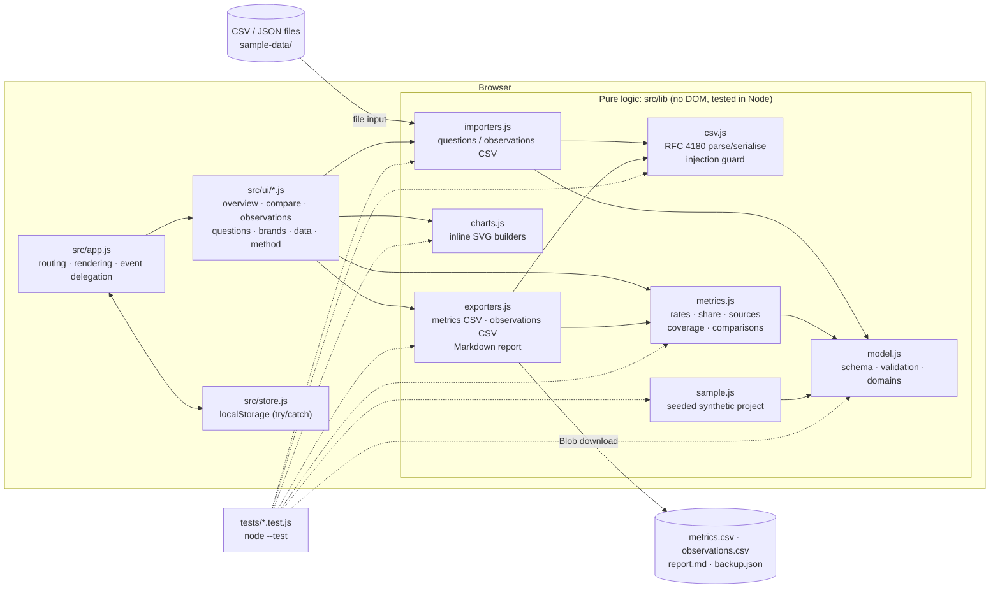

# Architecture

A static, zero-dependency single-page app. No build step, no server code, no network calls: the browser
loads `index.html`, the ES modules in `src/`, and keeps all data in `localStorage`.



## Layers

| Path | Responsibility |
|---|---|
| `index.html` | Shell: top bar, nav, banner slot, `<main>`, footer, status region, tooltip. |
| `src/app.js` | State holder, hash routing (`#/overview` …), render loop, delegated `click`/`submit`/`change`/`input` handlers, chart tooltip, resize redraw. |
| `src/store.js` | `localStorage` load/save under key `aeoGeoVisibilityLab.v1`; validates on load; failures surface as a banner, never a crash. |
| `src/ui/*.js` | One module per page. Each exports `render(ctx)` (HTML string) and optional `afterRender`, `actions`, `forms`, `changes`, `inputs` maps. All user text is escaped with `esc()`. |
| `src/lib/model.js` | Data model, id generation, domain normalisation and matching, validation of brands/questions/observations and of whole backups. |
| `src/lib/metrics.js` | Every metric formula, filters, breakdowns, coverage grid, matched-question comparisons. Rates are `{num, den, value, lowN}`; `value` is `null` when `den = 0`. |
| `src/lib/csv.js` | RFC 4180 parser (quotes, embedded commas/newlines, BOM, CRLF) and serialiser with CSV-injection protection. |
| `src/lib/importers.js` | CSV → project, returning `{ project, report }` with per-row errors/warnings; never mutates input. |
| `src/lib/exporters.js` | Observations/questions CSV (re-importable), long-format metrics CSV and Markdown report. |
| `src/lib/charts.js` | Bar, 100 % stacked bar and line charts as SVG strings sized to the container width. |
| `src/lib/sample.js` | Deterministic (seeded) illustrative project. |
| `scripts/` | Regenerates `sample-data/` from `sample.js`; tests check the files match. |

## Data model

```
State { schema, version: 1, activeProjectId, projects[] }
Project { id, name, description, illustrative, createdAt, brands[], questions[], observations[] }
Brand { id, name, role: target|competitor, domains[], aliases[] }
Question { id, text, intent: discovery|informational|comparison|purchase, notes }
Observation { id, questionId, platform, date, run, prompt, settings, answerSummary,
              brandsMentioned[brandId], citedUrls[], citedDomains[], notes }
```

Derived, never stored: the domains an observation cites (`observationDomains`: URL hosts ∪ manual domains)
and each domain's owner (`domainOwner`). Uniqueness key for observations: question + platform + date + run.

## Design decisions

- **Pure logic separated from the DOM** so every number on screen is produced by a tested function.
- **`null` instead of 0** for empty denominators, rendered as "n/a".
- **Charts are drawn at the container's pixel width** (re-drawn on resize) so text stays legible on phones;
  every chart has a data-table fallback and per-mark tooltips (`data-tip` + SVG `<title>`).
- **Colour follows the entity.** Brands keep their palette slot across all charts; platforms keep theirs even
  when filtered. Palette = the shared portfolio palette, reordered so adjacent slots pass a colour-vision-deficiency
  separation check; grey is reserved for third-party sources.
- **Imports are additive and idempotent**: duplicates are skipped, never overwritten.
- **Accessibility**: labelled inputs, visible focus rings, `aria-live` status messages, keyboard-focusable chart marks,
  tables that scroll inside their own container at narrow widths.

## Testing

`npm test` runs Node's built-in test runner (`node --test`) over `tests/*.test.js`: CSV edge cases, domain and
date validation, every metric against hand-computed fixtures, comparisons with missing data, import/export round
trips, sample determinism and chart output. UI flows were verified with a Playwright script kept outside the repo
(see the README's *Verification* section).
